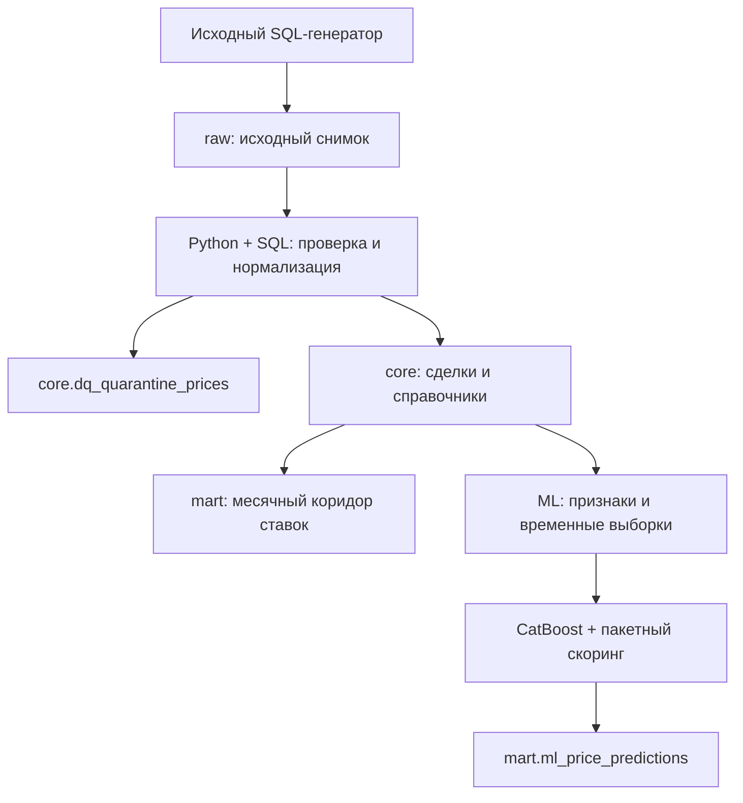

# Freight Rate Intelligence Platform

Платформа аналитики грузовых тарифов: включает в себя полный цикл Data Engineering + ML: генерацию синтетического источника, контроль качества данных, нормализацию, построение аналитических витрин, обучение модели, пакетный скоринг, идемпотентность и автоматические проверки.

Дата снимка **2026-10-26**. Используется воспроизводимый генератор **300 000 синтетических сделок**. Все денежные показатели — **RUB без НДС**.

## Быстрый запуск

Из корня проекта, на машине с Docker и Docker Compose:

```bash
docker-compose up
```

Копировать `.env.example` и вручную создавать базу не требуется. Compose:

1. Генерирует случайный пароль и сохраняет его в отдельном Docker volume.
2. Запускает PostgreSQL 17 и ждёт готовности БД.
3. Один раз создаёт `raw` и выполняет неизменённый генератор.
4. Создаёт `core`, карантин и `mart`; выполняет загрузку и расчёт коридора.
5. Обучает модель, считает метрики, записывает test/future прогнозы и запускает проверки.

Успешное окончание — JSON-событие `pipeline_succeeded` и завершение контейнера `pipeline` с кодом `0`. Контейнер БД продолжает работать. Отчёты и модель появляются в `artifacts/` на машине пользователя. Порт БД наружу не публикуется; SQL можно выполнять через `docker-compose exec db psql`.

Для просмотра результатов:

```bash
docker-compose logs pipeline
docker-compose exec db sh -c 'psql -U "$POSTGRES_USER" -d "$POSTGRES_DB"'
```

В другой консоли можно повторить полный цикл:

```bash
docker-compose run --rm pipeline
```

Генератор повторно не запускается, данные не задваиваются. При неизменных train/коде/настройках/версиях библиотек модель читается из проверенного по SHA-256 файла. Если изменён код образа, предварительно выполните `docker-compose build pipeline`.

## Результаты контрольного выполнения

Проверено на **PostgreSQL 17.11, Python 3.12.14, CatBoost 1.2.8**. Выполнен полный цикл на исходных 300 000 сделок.

| Результат | Значение |
| --- | ---: |
| Прочитано исходных сделок | 300 000 |
| Принято в core | 299 797 |
| Карантин | 203: 164 с неположительной ценой, 39 без даты валютного курса |
| Города после дедупликации | 40 из 42 исходных строк |
| Строки рыночной витрины | 203 644 |
| Train | 24 226 сделок |
| Test | 12 808 сделок |
| Прогнозы будущих заявок | 5 820 |
| Всего сохранено прогнозов | 18 628 |

| Метрика на test | Значение |
| --- | ---: |
| R² | **0,9211** |
| MAPE | **15,23%** |
| RMSE | **53 749,41 руб.** |
| MAE | **27 873,07 руб.** |

Это измеренные значения на заданном отложенном периоде, без подбора параметров по test. Ближайшее применение — сравнение предложений и ориентир тарифа с учётом ограничений ниже.

**61 тест пройден, без пропусков и ошибок.** Два одинаковых прогона очистки, витрины и ML дали одинаковые SHA-256 всех проверяемых строк; у повторного скоринга `prediction_rows_changed = 0`, включая сохранение `scored_at`. Повторная инициализация источника сохранила количество строк и сумму исходных цен.

Будущий пул содержит 6 003 исходные строки: 5 не прошли DQ, из оставшихся 178 имеют составной маршрут; все 5 820 допустимых простых заявок получили прогноз. В рыночной витрине 10 ячеек HIGH, 924 MEDIUM и 202 710 LOW_DATA: разреженность многих сочетаний маршрута/месяца/кузова/веса явно видна пользователю.

Полные машинные результаты и сведения о проверенной среде сохранены в `reports/`. При собственном запуске актуальные файлы записываются в `artifacts/`, без изменения контрольных отчётов.

## Архитектура и выбор инструментов



**PostgreSQL 17** обслуживает источник, очищенный слой и аналитические таблицы. Для 300 тысяч строк SQL-агрегации и индексы позволяют обойтись одной СУБД. Цены нормализуются в `numeric`, непрерывные перцентили считаются `percentile_cont`. `core` и рыночная витрина публикуются одной транзакцией.

**Python 3.12 + psycopg 3** отвечает за параметры запуска, транзакции, контроль ошибок, журналирование и ML. Массовая очистка выполняется SQL-запросами, прогнозы загружаются через `COPY`. Построчных `INSERT` в рабочем конвейере нет.

**CatBoostRegressor** использует категории напрямую. Зафиксированы seed, число итераций, настройки CPU и версии библиотек. Преобразования признаков не обучаются на общей выборке.

**Оркестратор** — небольшой Python CLI с явными этапами и журналом запусков. Это позволяет проверить обязательную часть одной командой. Airflow, Superset и ClickHouse не добавлены: для локального pet-проекта они увеличили бы число сервисов без существенного улучшения демонстрируемого результата.

### Физическая модель

| Объект | Зерно и назначение |
| --- | --- |
| `raw.prices`, справочники и связи | Синтетический исходный слой, сохранённый без изменения структуры |
| `core.prices` | Одна прошедшая DQ запись на `price_id`, исходная цена + курс + `price_rub` |
| `core.dim_cities` | Одна строка на `gc_id`; выбран минимальный `raw.cities.id` |
| `core.price_body_groups` | Уникальная пара `price_id × body_group_id` |
| `core.price_dates` | Уникальная пара `price_id × price_date` |
| `core.dq_quarantine_prices` | Одна текущая отбракованная запись на `price_id`, массив причин и исходная строка JSON |
| `mart.mart_market_corridor` | Месяц × отправление × назначение × группа кузова × весовая категория |
| `mart.mart_route_card` | Представление над той же таблицей для карточки маршрута |
| `mart.ml_price_predictions` | Одна оценка на `(as_of, price_id)` |
| `mart.ml_models`, `mart.ml_evaluations` | Версия модели, происхождение train, параметры, метрики отложенной выборки |
| `ops.pipeline_runs` | Журнал запусков со статусом, параметрами, численностями и ошибкой |

## Этап 1. Очистка и нормализация

Реализация: `sql/001_core.sql`, `sql/010_load_core.sql`, `etl/`.

### Правила DQ

- `price <= 0`; дополнительно для RUB — `0 < price <= 1000`.
- `distance <= 0`, отрицательные вес или объём; нулевой вес/объём допустимы.
- Отсутствие любого города в текущем исходном справочнике.
- `NaN`/`Infinity` в цене, дистанции, весе или объёме.
- Неизвестный код валюты; отсутствующая дата/точный курс иностранной валюты; конфликтующие либо неположительные/нечисловые курсы.

Все найденные причины сохраняются одновременно в `reason_codes`. Поэтому сумма счётчиков причин может превышать число отклонённых строк. Карантин содержит актуальное состояние; история запусков отдельно хранится в `ops.pipeline_runs`. Одинаковый город отправления и назначения **не является причиной отбраковки**.

Для RUB курс равен `1`, независимо от наличия `nearest_rate_date`. Для USD/EUR ищется **только точное** соответствие `(currency_code, nearest_rate_date)`. Указанная дата уже рассчитана источником относительно `created_at`. Конвейер её не восстанавливает и не подставляет дату погрузки. Одинаковые повторные котировки схлопываются; разные значения на одну дату направляют сделку в карантин. Итоговый тариф округляется до копеек один раз после умножения.

Дата курса считается частью контракта синтетического источника. Если она отсутствует, строка получает `MISSING_RATE_DATE` и не проходит нормализацию валюты.

Весовая категория заполняется, если исходное поле NULL/пустое: сначала `round(total_weight::numeric, 1)`, затем пороги `30 / 10 / 5 / 2.5 / 0.5`. Например, `9.95` т → `10.0` → `FTL`. Отрицательный вес отбраковывается до этого преобразования. Объём: `FTL` при `0 < V <= 120`, иначе `OTH`. Непустые исходные категории сохраняются.

`outlier_mark` сохраняется в core без пересчёта. Помеченные аномалии исключаются из рынка и исторического ML-target, но не исчезают из очищенного слоя. **Самые свежие записи за 2026-10-26 ещё могли не пройти ночную разметку**: `false` не гарантирует отсутствие выброса. Дополнительное отсечение по test не применяется.

### Идемпотентность, исправления и backfill

Окно определяется по `loading_date`, начало включительно, конец **не включительно**. В рабочий набор попадают IDs текущего исходного окна и IDs, ранее находившиеся в core/карантине этого окна. Затем набор атомарно пересобирается из текущего полного raw-снимка.

Это обрабатывает повторную загрузку, изменение цены, переходы valid ↔ quarantine, удаление исходной строки и перенос даты за границы прежнего окна. Связи кузовов/дат обновляются вместе с ценой. Рыночная витрина полностью пересчитывается в той же транзакции, включая месяцы долгосрочных заявок и зависимые MoM/YoY.

```bash
docker-compose run --rm pipeline python -m etl.pipeline etl \
  --start-date 2026-09-01 --end-date 2026-10-01

docker-compose run --rm pipeline python -m etl.pipeline verify-idempotency
docker-compose run --rm pipeline python -m etl.pipeline verify-idempotency --include-ml
```

Проверка идемпотентности сравнивает SHA-256 **всех упорядоченных бизнес-строк**, включая квартильные значения, до и после второго одинакового прогона. Флаг `--include-ml` также повторяет скоринг и проверяет модели, метрики и прогнозы, включая неизменность `scored_at`. Записи аудита намеренно добавляются для каждого запуска.

Загрузка предполагает полный исходный снимок, а не поток частичных удалений. Если исправлен старый курс или глобальный справочник, backfill должен включать все затронутые сделки; без CDC таких зависимостей автоматически не узнать. Для используемого статического набора полный пересчёт является простым и надёжным вариантом. Глобальная блокировка сериализует запуски ETL/витрин/ML.

## Этап 2. Рыночный коридор

Полный запрос: `sql/020_mart.sql`; вызов функции — `sql/030_refresh_mart.sql`.

1. Месяц берётся из **`price_dates.price_date`**. Ограничение `price_date <= as_of` применяется **до** округления до месяца; 27 октября не попадает в историю снимка от 26 октября.
2. Несколько дат одной цены внутри месяца схлопываются. В разных месяцах долгосрочная заявка участвует согласно источнику.
3. Связи `price_body_types` первичны. При их отсутствии берётся `prices.body_type`, затем группа «Не указан». Несколько дочерних кодов одной группы дают одну строку. Разные группы сохраняются.
4. В рынок входят факты типов `1/2/3/4/5/9`, прямые маршруты, валидные цены и расстояния, без `outlier_mark`.
5. `volume_category` остаётся в core и ML, но не дробит месячную рыночную ячейку.

В таблице рассчитаны `p25_trip`, `median_trip`, `p75_trip`, `avg_trip`, `p25_km`, `median_km`, `p75_km`, `trips_count`, `carriers_count`, `cv_rate`, `mom_pct`, `yoy_pct`, `reliability_level`. Перцентили за километр считаются по индивидуальному `price_rub / distance`, а не делением квартиля цены на среднюю дистанцию.

Число перевозчиков — `COUNT(DISTINCT organization_id)` только для типов **3 и 9**. `cv_rate` — доля, например `0.2` означает 20%; для одного наблюдения это NULL. MoM/YoY используют точное соединение по календарному месяцу, не `LAG` к последней имеющейся строке.

Для неоднозначной формулировки «свежесть последнего месяца» принята явная измеримая трактовка: `as_of - max(допущенной price_date)` **в текущей месячной ячейке**. Дата сохранена как `latest_price_date`. Уровень HIGH требует не менее 30 цен, 5 перевозчиков и давность 0–30 дней; MEDIUM — не менее 10 цен; иначе LOW_DATA. Исторические месяцы автоматически не становятся HIGH за счёт свежих наблюдений другого месяца.

**Числа рейсов неаддитивны по кузовам и месяцам**: одна цена может относиться к двум совместимым группам или долгосрочному периоду. Для общей уникальной численности нужен `COUNT(DISTINCT price_id)` на соответствующем слое, а не сумма всех `trips_count`.

## Этап 3. Признаки, обучение и скоринг

Подробности: `ml/README.md`. Разделение задано календарно, независимо от системной даты:

| Выборка | Даты погрузки |
| --- | --- |
| Train | `[2026-07-26, 2026-10-05)` |
| Test | `[2026-10-05, 2026-10-26]` |
| Future | `> 2026-10-26` |

ML использует **одну строку на сделку**, без разворачивания месячных дат. Совместимые группы кузова представлены одной отсортированной строкой категорий; отдельно учитывается основная группа исходного кузова.

В явный разрешённый список включены расстояние, вес/объём, категории, раздельные города и регионы, координаты, год и sin/cos для месяца, дня недели, дня года. Входной `DataFrame` не передаётся модели целиком. Цены, удельные тарифы текущего рейса, `outlier_mark`, `price_type`, организационные IDs, `price_group_id` и статистики `price_group_stats` в признаки не входят.

CatBoost обучается только на train: 500 итераций, depth 6, learning rate 0.06, RMSE, Ordered boosting, `has_time=True`, seed `20261026`. Данные отсортированы по `loading_date, price_id`. Test не используется для early stopping, выбора параметров, вычисления статистик или отсечения неудобных наблюдений. Числовые пропуски координат обрабатывает CatBoost; отсутствующая текстовая категория заменяется константой «Не указан».

Для test записываются факт, прогноз, абсолютная ошибка и APE. Для future, включая валидные аукционные заявки, факт и ошибки всегда NULL; это проверено в SQL, Python и ограничением таблицы. Будущий `outlier_mark` не отбирает строки для скоринга. Покрываются заявки, прошедшие общую DQ-загрузку в core. Для заявок с неизвестной/нулевой ценой в production следует отделить вход для прогнозирования от контроля исторического target; текущий контракт входных данных отбраковывает такие цены.

Модель получает идентификатор от train, кода признаков/выборки, параметров и версий библиотек. Файл `.cbm`, манифест, хеши данных и метрики позволяют проверить происхождение прогноза. Публикация выполняется через `COPY` во временную таблицу и `ON CONFLICT`; для неизменных строк `scored_at` сохраняется. Исчезнувшие из текущего пула прогнозы удаляются, другие `as_of` остаются историей.

### Ограничения интерпретации

- Историческая выборка объединяет несколько типов рыночных ролей. Для production-сценария target следует формализовать отдельно для конкретного продукта и сегмента пользователей.
- Трёхмесячное окно содержит ограниченную сезонность и фактически один год. Наличие `year` и гармоник само по себе не доказывает способность прогнозировать декабрь или долгосрочную инфляцию.
- В сырье нет истории изменения справочников/признаков. Это проверка фиксированного снимка с временным разделением, а не восстановление исторического состояния данных на каждую дату. `dim_cities` обновляется как SCD1.
- Метрики получены на синтетических данных и не являются обещанием качества на реальных перевозках. Они показывают воспроизводимость пайплайна и корректность временной валидации.

## Проверки

После первого полного запуска:

```bash
docker-compose run --rm pipeline python -m pytest -q
```

Чистые тесты признаков и модели выполняются без БД; интеграционные требуют `TEST_DATABASE_URL`. Чтобы запустить **весь** набор в Compose с автоматически созданным паролем:

```bash
docker-compose run --rm pipeline python -c \
  'import os,pytest; from etl.db import database_url; os.environ["TEST_DATABASE_URL"]=database_url(); raise SystemExit(pytest.main(["-q"]))'
```

Интеграционные фикстуры используют отдельные IDs и транзакции с откатом. Проверяются DQ и карантин, повторные загрузки и исправления, точные курсы, весовые границы, дубли справочника и кузовов, числовые квартильные ожидания, пропущенные календарные месяцы, надёжность, временные границы, отсутствие целевых признаков и NULL-ошибки будущего.

```bash
docker-compose run --rm pipeline python -m etl.pipeline check
docker-compose run --rm pipeline python -m etl.pipeline verify-idempotency
```

## Структура проекта

| Каталог / файл | Содержимое |
| --- | --- |
| `etl/` | Инициализация источника, CLI, соединение, журналирование, проверки |
| `sql/source/` | Схема и генератор синтетического источника |
| `sql/001_core.sql`, `010_load_core.sql` | DDL и массовая нормализация |
| `sql/020_mart.sql`, `030_refresh_mart.sql` | Физическая витрина и запрос обновления |
| `sql/090_checks.sql` | SQL-проверки инвариантов |
| `ml/` | Признаки, запрос обучающей выборки, обучение, скоринг, описание |
| `tests/` | Чистые и интеграционные тесты |
| `docker/`, `docker-compose.yml` | Образы, credentials и запуск |
| `reports/` | Результаты фактически выполненной проверки |
| `artifacts/` | Выход собственного запуска: модель, манифест, метрики, примеры |
